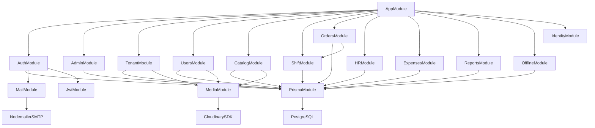

# SunTech POS Backend — Architecture Reference

> **Version:** 2.1.0
> **Stack:** NestJS 11 · Express · Prisma ORM 6 · PostgreSQL 16
> **Runtime:** Node.js 20+ · TypeScript 5
> **Status:** Production-Ready Core (31 test suites, 312 tests, zero build errors)

---

## 1. Repository Layout

```
suntech-pos-backend/
├── prisma/
│   ├── schema/              # Multi-file Prisma schema
│   │   ├── pos.prisma       # Core POS models (orders, catalog, shifts, HR)
│   │   └── tenant.prisma    # Tenant models (business, location, user)
│   ├── migrations/          # PostgreSQL migration history
│   └── seed.ts              # CLI seeder (npm run seed)
├── src/
│   ├── admin/               # Super Admin user approvals + bootstrap SeedService
│   ├── auth/                # JWT login, register, OTP reset, refresh, logout
│   ├── catalog/             # Categories, Products, Variants, Images, Stock
│   ├── common/              # Shared filters, guards, interceptors, decorators, utils
│   ├── config/              # Environment validation (validate-env.ts)
│   ├── expenses/            # Admin operational expense ledger
│   ├── hr/                  # Salary advances + payroll processing
│   ├── identity/            # User profile, profile images, /users/me
│   ├── mail/                # Nodemailer SMTP + HTML email templates
│   ├── media/               # Cloudinary upload/delete service
│   ├── offline/             # PWA bootstrap snapshot + order sync engine
│   ├── orders/              # Dual-engine checkout (catalog + custom), refunds
│   ├── prisma/              # PrismaService (global database client)
│   ├── reports/             # Dashboard, analytics, transaction log, CSV/PDF export
│   ├── shifts/              # Shift open/close, auto-close, drawer reconciliation
│   ├── tenant/              # Business CRUD, Location CRUD, profile images
│   ├── users/               # Cashier CRUD, status management, audit logging
│   ├── app.module.ts        # Root NestJS module
│   └── main.ts              # Bootstrap, CORS, Swagger, global pipes/filters
├── test/                    # E2E test configuration
├── docs/
│   ├── POS.md               # Master API specification (single source of truth)
│   └── Arch.md              # This file — architecture overview
└── .env.example             # Required environment variables template
```

---

## 2. Module Dependency Graph



---

## 3. Multi-Tenant Data Isolation

```
Admin (owner)
 └── Business (1:N per admin)
      ├── Location / Branch (1:N per business)
      ├── Category → Product → Variant → LocationStock
      ├── Order → OrderLine → Refund → RefundItem
      ├── ShiftSession
      ├── EmployeeAdvance / PayrollRecord
      ├── Expense
      └── User (Cashier, scoped to one business + branch)
```

**Compound uniqueness rules** prevent cross-tenant collisions:
- `Business` — `@@unique([ownerId, name])`
- `Category` — `@@unique([businessId, name])`, `@@unique([businessId, slug])`
- `Product` — `@@unique([businessId, name])`
- `Variant` — `@@unique([businessId, sku])`, `@@unique([businessId, barcode])`
- `Location` — `@@unique([businessId, name, address])`
- `User` — `@@unique([businessId, phoneNumber])`

Only `User.email` and system-minted identifiers (`publicId`, `invoiceNumber`) are globally unique.

---

## 4. Request Processing Pipeline

```
HTTP Request
  │
  ├─ ThrottlerGuard (60 req/min global; 5 req/min on auth routes)
  ├─ ValidationPipe (whitelist: true, DTO validation)
  ├─ JwtAuthGuard → JwtStrategy (DB-verified: active, not deleted)
  ├─ RolesGuard (@Roles decorator)
  ├─ IdempotencyInterceptor (POST/PATCH/PUT/DELETE with Idempotency-Key)
  ├─ Controller → Service → PrismaService → PostgreSQL
  ├─ SalaryMaskingInterceptor (strips cost/salary fields for Cashiers)
  └─ TransformInterceptor ({ success, message, data, timestamp })
  │
  └─ GlobalExceptionFilter (Prisma P2002/P2025 → HTTP, stack masking)
```

---

## 5. Security Architecture

| Layer | Implementation |
|---|---|
| Password hashing | bcrypt (10 rounds) |
| OTP storage | bcrypt-hashed `resetOtpHash`, never plaintext |
| JWT access token | `JWT_ACCESS_SECRET`, 7d default TTL |
| JWT refresh token | `JWT_REFRESH_SECRET`, 30d, HttpOnly cookie only |
| JWT reset token | `JWT_RESET_SECRET` (mandatory, no fallback), 10m |
| Pre-login guard | Checks `deletedAt` and `status` before `bcrypt.compare` |
| DB check per request | `JwtStrategy` validates user is active + not deleted on every request |
| Rate limiting | `@nestjs/throttler` — 60/min global, 5/min on sensitive auth |
| CORS | Production strips localhost origins; configured via `FRONTEND_URL` |
| Cookie security | `httpOnly: true`, `sameSite: 'lax'`, `path: '/api/v1/auth'` |
| Cashier synthetic emails | `@cashiers.suntech.internal` blocked from SMTP dispatch |

---

## 6. Financial Integrity

- **Integer currency:** All amounts are whole BDT integers (no paisa). Overflow protection asserts `< INT_MAX`.
- **Serializable transactions:** Catalog deletion safeguards, advance salary caps, and invoice generation use `Prisma.TransactionIsolationLevel.Serializable`.
- **Invoice retry:** Up to 3 automatic retries on PostgreSQL `P2034` serialization conflicts.
- **Advance salary cap:** `pendingAdvances + newAmount <= monthlySalary` enforced in serializable transaction.
- **Payroll guard:** `netPaid >= 0` enforced; deductions cannot exceed base salary.
- **Shift drawer integrity:** Closed shifts are immutable; refunds only adjust active open shifts.
- **Negative stock:** Allowed by design for backorder scenarios.

---

## 7. Catalog Deletion Safeguards

All deletion operations run inside `Serializable` transactions to prevent race conditions:

| Entity | Blocks deletion if | HTTP |
|---|---|---|
| Category | Active products exist, or any product (including archived) has historical order lines | 409 |
| Product | Any variant has order line history, or any variant has nonzero global/branch stock | 409 |
| Variant | Order line history exists, or global/branch stock is nonzero | 409 |
| Product (recategorize) | Changing `categoryId` when product has order lines | 409 |
| Variant (reparent) | Changing `productId` when variant has order lines | 409 |

Successful deletions use soft-archive: unique columns are suffixed with `__del_${Date.now()}` for collision-free code reuse.

---

## 8. Soft-Delete & Collision-Free Reuse

When an entity is soft-deleted (`deletedAt = new Date()`), its unique columns are suffixed:

| Entity | Suffixed columns |
|---|---|
| Category | `name`, `slug` |
| Product | `name` |
| Variant | `sku`, `barcode` (if non-null) |
| Location | `name` |
| User (Cashier) | `email`, `publicId`, `phoneNumber` (if non-null) |

The `SalaryMaskingInterceptor` strips `__del_\d+$` suffixes from all serialized string values so deletion timestamps never appear in API responses.

---

## 9. Timezone & Shift Day Boundaries

All shift, analytics, and payroll boundaries use **Asia/Dhaka** (UTC+6):

- `getDhakaRange()` — today, yesterday, weekly, monthly
- `getDhakaPeriod()` — daily, weekly, monthly, quarterly
- `getDhakaMonthRange()` — exact payroll month window

Shift auto-close evaluates `isPreviousCalendarDay` in Dhaka time. Same-day shifts are never auto-closed.

---

## 10. Environment Requirements

Required variables (validated at startup via `validate-env.ts`):

| Variable | Purpose |
|---|---|
| `DATABASE_URL` | PostgreSQL connection string |
| `NODE_ENV` | `development` / `production` / `test` |
| `PORT` | TCP port (1–65535) |
| `FRONTEND_URL` | CORS origin; no localhost in production |
| `JWT_ACCESS_SECRET` | Access token signing |
| `JWT_REFRESH_SECRET` | Refresh token signing |
| `JWT_RESET_SECRET` | Password reset token (mandatory, no fallback) |
| `BCRYPT_ROUNDS` | Hash cost factor (default 10) |
| `SUPER_ADMIN_EMAIL` | Bootstrap super admin |
| `SUPER_ADMIN_PASSWORD` | Bootstrap super admin |
| `RUN_BOOTSTRAP_SEED` | `'true'` to enable startup seeding |
| `CLOUDINARY_*` | Cloud media storage credentials |
| `SMTP_*` | Email delivery credentials |

---

## 11. API Prefix & Response Envelope

- **Base path:** `/api/v1`
- **Success:** `{ success: true, message: string, data: any, timestamp: string }`
- **Error:** `{ success: false, message: string | string[], timestamp: string }`
- **Swagger:** `/api/docs` (JSON at `/api/docs-json`)
- **File exports:** PDF/CSV streamed directly (bypass JSON envelope)

---

## 12. Testing & Verification

| Check | Command | Current Status |
|---|---|---|
| Unit tests | `npm test -- --runInBand` | 31 suites, 312 tests, 100% pass |
| E2E tests | `npm run test:e2e` | Passing (requires PostgreSQL) |
| TypeScript build | `npm run build` | Zero errors |
| Prisma validation | `npx prisma validate` | Clean |
| Prisma generation | `npx prisma generate` | Clean |

---

## 13. Deployment Checklist

1. Set all required environment variables (see §10)
2. `npx prisma migrate deploy` — apply migrations (never `migrate reset` in production)
3. `npx prisma generate` — generate Prisma client
4. `npm run build` — compile TypeScript
5. `node dist/main` — start production server
6. Verify `/api/docs` loads, health endpoint responds
7. Optional: `RUN_BOOTSTRAP_SEED=true` on first deploy for super admin account

---

*Authoritative API contract details are in [`POS.md`](file:///d:/Project/SuntechPOS-backend/docs/POS.md). This document provides the structural overview.*
