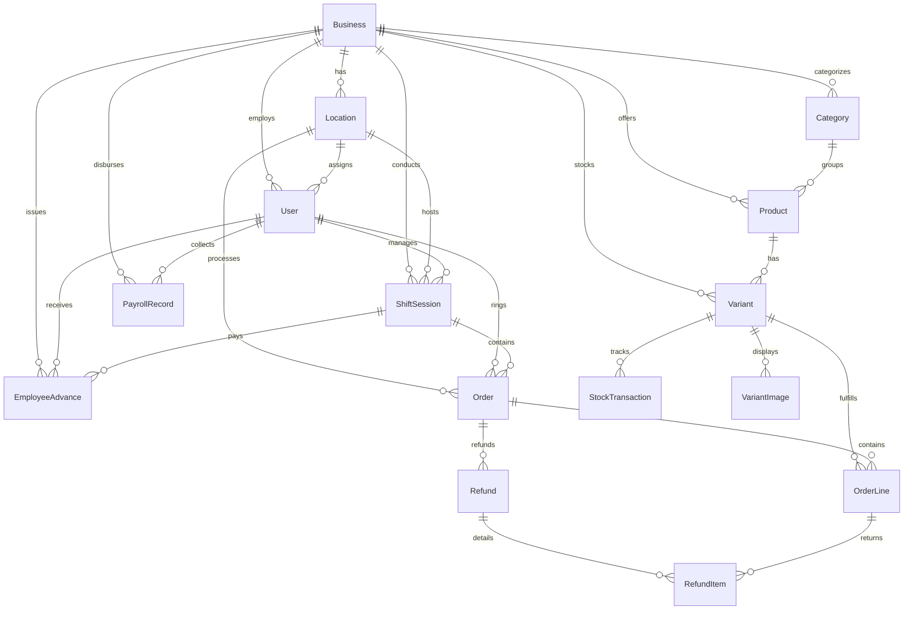

# SunTech POS: Master Backend Architecture & API Specification

> **Version:** 2.1.0  
> **Framework:** NestJS 11 + Express + Prisma ORM 6 + PostgreSQL 16  
> **Status:** Production-Ready Core  
> **Single Source of Truth:** Documents all architectural guardrails, data contracts, security mechanics, and edge case behaviors across all backend services.

---

## 1. Global Architecture & System Guardrails

### 1.1 Global Exception Filter (`GlobalExceptionFilter`)

- **File:** [`src/common/filters/global-exception.filter.ts`](file:///d:/Project/SuntechPOS-backend/src/common/filters/global-exception.filter.ts)
- **Envelope Format:**
  ```json
  {
    "success": false,
    "message": "Human-readable error description or array of validation errors",
    "timestamp": "2026-10-18T12:00:00.000Z"
  }
  ```
- **Security & Sanitization:**
  - Catches all `HttpException` instances and extracts response messages cleanly.
  - Catches unhandled system errors (`500 Internal Server Error`) and logs internal error stacks via NestJS `Logger` while masking the user-facing message strictly as `"Internal server error"`.
  - Catches Prisma database errors (such as `P2002` unique constraint violations or `P2025` record not found) and translates them into appropriate HTTP status codes (`409 Conflict`, `404 Not Found`).

### 1.2 Global Response Transform (`TransformInterceptor`)

- **File:** [`src/common/interceptors/transform.interceptor.ts`](file:///d:/Project/SuntechPOS-backend/src/common/interceptors/transform.interceptor.ts)
- **Envelope Format:**
  ```json
  {
    "success": true,
    "message": "Entity created / loaded successfully",
    "data": { ... },
    "timestamp": "2026-10-18T12:00:00.000Z"
  }
  ```
- **Behaviors:**
  - Uses `@ResponseMessage('...')` decorator set on controller handlers. Defaults to `"Success"` if omitted.
  - Bypasses file stream responses (`StreamableFile` for PDF/CSV exports) so binary data is streamed directly with attachment headers without JSON encapsulation.

### 1.3 Idempotency Engine (`IdempotencyInterceptor` & `IdempotencyRecord`)

- **File:** [`src/common/interceptors/idempotency.interceptor.ts`](file:///d:/Project/SuntechPOS-backend/src/common/interceptors/idempotency.interceptor.ts)
- **Database Model:** `IdempotencyRecord` in PostgreSQL with compound index `@@unique([scopeId, key])`.
- **Header:** `Idempotency-Key` (1–200 characters string).
- **Execution Flow & Concurrency Control:**
  1. **Method Check:** Only intercepts mutating methods (`POST`, `PATCH`, `PUT`, `DELETE`). `GET`, `HEAD`, `OPTIONS` pass through automatically.
  2. **Scope Resolution:** Scoped per user `actor.sub`. If anonymous, resolves to client IP (`x-forwarded-for` or socket remote address).
  3. **Atomic In-Flight Lock:** Creates an `IdempotencyRecord` with `statusCode: 0` (`PENDING_STATUS`) inside PostgreSQL. If two concurrent identical requests hit the server, PostgreSQL rejects the second with a unique constraint error (`P2002`), causing the interceptor to return `409 Conflict` (`"A request with this idempotency key is already in progress"`).
  4. **Path Mismatch Rejection:** If an existing key was already used for a different endpoint path, throws `409 Conflict` (`"Idempotency key was already used for a different request"`).
  5. **Replay Cache (24-Hour TTL):** If a completed record exists and `expiresAt > now()`, immediately serves the stored `responseBody` with the exact stored `statusCode` without re-executing controller logic.
  6. **Safe Lock Release on Failure:** If the underlying handler throws an error, the in-flight lock (`statusCode: 0`) is deleted immediately so the client can safely retry without being locked out.
- **Storage Architecture:**
  - Implemented directly in PostgreSQL via Prisma for ACID transaction durability across server restarts.
  - _Roadmap for High-Concurrency Redis Upgrade:_ Can be adapted to Redis `SET key value NX PX 86400000` for sub-millisecond lock acquisition.

### 1.4 Cryptography & Authentication Security

- **Pre-Login Account Status Guard:**
  - The authentication pipeline checks `user.deletedAt !== null` or `user.status !== AccountStatus.ACTIVE` (`SUSPENDED`, `REJECTED`, `PENDING_APPROVAL`) **prior** to running `bcrypt.compare()`.
  - Rejects inactive or suspended accounts immediately (`403 Forbidden: "Account is suspended/pending"`), thwarting timing side-channel attacks, hash-burning denial-of-service, and credential enumeration against suspended accounts.
- **Password Hashing:**
  - Uses `bcrypt` with `BCRYPT_ROUNDS = 10`.
  - Passwords must meet minimum complexity requirements (min 8 chars, uppercase, lowercase, number, special char).
- **One-Time Passwords (OTP):**
  - Generated with cryptographically secure pseudo-random numbers via Node.js `crypto.randomInt(100000, 1000000).toString()` (6-digit numeric OTP).
  - Plaintext OTP is **never** saved in the database; it is hashed with `bcrypt` (`resetOtpHash`) and verified with `bcrypt.compare()`.
  - Strictly expires in 15 minutes (`OTP_TTL_MS = 15 * 60 * 1000`).
  - Cashier password resets are orchestrated directly by Store Admins via `PATCH /users/cashiers/:id` since cashiers may lack personal external emails.
- **JWT Token Lifecycles, Claims & Cookie Delivery:**
  - `JWT_ACCESS_SECRET` / `JWT_ACCESS_TTL` (default `7d`).
  - `JWT_REFRESH_SECRET` / `JWT_REFRESH_TTL` (default `30d`).
  - **Token Delivery:** Refresh tokens are never exposed in JSON response bodies; they are transmitted exclusively via secure HTTP-Only cookies (`refreshToken`, `httpOnly: true`, `sameSite: 'lax'`, `path: '/api/v1/auth'`).
  - **Role Claim Rules:**
    - `SUPER_ADMIN`: `{ sub, role: 'SUPER_ADMIN' }` (no businessId or locationId embedded).
    - `ADMIN`: `{ sub, role: 'ADMIN' }` (no businessId or locationId embedded in token; resolved from request or DB ownership).
    - `CASHIER`: `{ sub, role: 'CASHIER', publicId, businessId, locationId }` (strictly bounded to assigned store location).
  - **Database Active Check on Every JWT Request:** `JwtStrategy` validates against PostgreSQL on every authenticated request that the account exists, is active (`status: ACTIVE`), and has not been soft-deleted (`deletedAt: null`).

### 1.5 Rate Limiting (`ThrottlerGuard`)

- **File:** Configured globally in [`src/app.module.ts`](file:///d:/Project/SuntechPOS-backend/src/app.module.ts).
- **Policy:**
  - Default global rate limit: 60 requests per minute (`60_000ms`, `limit: 60`).
  - Sensitive auth routes (`/auth/login`, `/auth/register`, `/auth/forgot-password`, `/auth/verify-otp`, `/auth/reset-password`): strictly throttled to 5 requests per minute (`@Throttle({ default: { limit: 5, ttl: 60_000 } })`).
  - Excess requests receive `429 Too Many Requests` (`"ThrottlerException: Too Many Requests"`).

### 1.6 Management Masking Interceptor (`SalaryMaskingInterceptor`)

- **File:** [`src/common/interceptors/salary-masking.interceptor.ts`](file:///d:/Project/SuntechPOS-backend/src/common/interceptors/salary-masking.interceptor.ts)
- **Rule:** Cashiers must never observe salaries, wholesale costs, margins, or inventory value in any API response.
- **Mechanism:**
  - Recursively walks response payloads (objects, arrays, nested relations).
  - Whenever `request.user?.role === Role.CASHIER`, strips management-only keys: `monthlySalary`, `costPrice`, `marginPercent`, `inventoryValue`, `salesRevenue`, `salesCount`.
  - For all roles, strips soft-delete suffixes matching `/__del_\d+$/` from all serialized string values so deleted staff, categories, or items never render with internal deletion timestamps in historical receipts or reports.

### 1.7 Integer Currency Discipline & Overflow Protection

- **Files:** [`src/orders/money.ts`](file:///d:/Project/SuntechPOS-backend/src/orders/money.ts), Prisma Schemas.
- **Storage Standard:** All financial amounts are stored as whole integer numbers representing currency subunits (BDT taka / paisa).
- **Guards:**
  - Prevents IEEE-754 floating-point inaccuracies (e.g., `0.1 + 0.2 !== 0.3`).
  - Overflow protection asserts amounts do not exceed PostgreSQL 32-bit signed integer limits (`INT_MAX = 2,147,483,647`).
  - Negative value validation asserts monetary inputs (`amount`, `sellingPrice`, `startingAmount`, `unitPrice`) are non-negative.

### 1.8 Soft-Delete Mechanics, Safe Deletion & Collision-Free Code Reuse

- **Files:** [`src/catalog/category.service.ts`](file:///d:/Project/SuntechPOS-backend/src/catalog/category.service.ts), [`src/catalog/product.service.ts`](file:///d:/Project/SuntechPOS-backend/src/catalog/product.service.ts), [`src/catalog/variant.service.ts`](file:///d:/Project/SuntechPOS-backend/src/catalog/variant.service.ts), [`src/tenant/tenant.service.ts`](file:///d:/Project/SuntechPOS-backend/src/tenant/tenant.service.ts), [`src/users/user.service.ts`](file:///d:/Project/SuntechPOS-backend/src/users/user.service.ts).
- **Mechanism:**
  - Entities use `deletedAt: DateTime?`. Active entities satisfy `deletedAt: null`.
  - When soft-deleting an entity, unique columns are appended with `__del_${Date.now()}`:
    - **Category:** `name`, `slug`.
    - **Product:** `name`.
    - **Variant:** `sku`, and `barcode` (if non-null).
    - **Location:** `name`.
    - **User (Cashier):** `email`, `publicId` (if non-null), and `phoneNumber` (if non-null). Cashier account status is set to `SUSPENDED`.
  - **Deletion Safety Checks:**
    - Deleting a Location checks for active open shifts (`ShiftStatus.OPEN`) and throws `409 Conflict` (`"Cannot delete a location with an active open shift"`).
    - Deleting a Cashier checks for active open shifts (`ShiftStatus.OPEN`) and throws `409 Conflict` (`"Cannot delete a cashier with an active open shift"`).
  - **Admin Self-Suspension Lockout Guard:**
    - An Admin is strictly prohibited from updating their own account status to `SUSPENDED` or `REJECTED` (`400 Bad Request: "You cannot suspend or reject your own admin account"`), preventing permanent tenant lockout.
  - **Collision-Free Reuse:** Allows an admin to recreate a product with the identical SKU/barcode or re-register an employee phone number immediately without triggering PostgreSQL unique index conflicts (`P2002`).

### 1.9 Multi-Tenant Architecture: "1 Admin -> Multiple Businesses -> Multiple Branches"

- **Architectural Hierarchy:**
  - **1 Admin** can create, own, and manage **Multiple Businesses** (`Business.ownerId` is indexed and compound-unique with `name`: `@@unique([ownerId, name])`).
  - **Each Business** contains **Multiple Branches** (`Location`).
  - **Admin** selects an active Business first, then selects/manages one of that Business's Branches.
  - **Cashiers** are assigned to a single `businessId` and `locationId` upon creation/invitation and are strictly locked to their assigned business and branch.
- **Tenant Compound Uniqueness Rules:**
  - Global `@unique` is restricted strictly to `User.email` (for multi-tenant Admin login) and system-minted identifiers (`publicId`, `invoiceNumber`).
  - All operational entities are compound-unique per tenant:
    - `Business`: `@@unique([ownerId, name])`
    - `Category`: `@@unique([businessId, name])`, `@@unique([businessId, slug])`
    - `Product`: `@@unique([businessId, name])`
    - `Variant`: `@@unique([businessId, sku])`, `@@unique([businessId, barcode])`
    - `Location`: `@@unique([businessId, name])`
    - `User`: `@@unique([businessId, phoneNumber])`
- **Location Scope Enforcement (`resolveLocationScope`):**
  - **Caller is `CASHIER`:** `businessId` and `locationId` are strictly resolved from the authenticated JWT token. Any attempt to supply a different `locationId` in the query or body throws `403 Forbidden` (`"Cashiers can only access their assigned branch location"`).
  - **Caller is `ADMIN`:** `businessId` is resolved from query parameter `businessId`, header `x-business-id`, or caller's active `actor.businessId` token claim (verifying `ownerId === admin.sub`). Admin can pass optional `locationId` to filter down to a specific branch, or omit `locationId` to aggregate across all branches.
  - Cashiers with no assigned `locationId` or `businessId` in DB are blocked from logging in.

### 1.10 Asynchronous Processing & Queue Roadmap

- **Current State:**
  - Email dispatch: Direct asynchronous delivery via Nodemailer SMTP with HTML templates (`EmailTemplateService`). Cashiers with internal synthetic emails (`@cashiers.suntech.internal`) are prevented from triggering external SMTP delivery.
  - Report generation: In-memory streaming via PDFKit and CSV buffers (`ExportService`).
- **Enterprise Scaling Roadmap (BullMQ + Redis):**
  - Mail Queue: Move `mailService.deliver()` to BullMQ `@Processor('mail')` with Redis backing, providing exponential backoff retries, dead-letter queues, and decoupling SMTP latency from HTTP requests.
  - Report Queue: Offload complex multi-year analytics PDF generation to BullMQ `@Processor('reports')` with pre-signed Cloudinary/S3 download links.

### 1.11 Cloudinary Media Storage

- **File:** [`src/media/cloudinary.service.ts`](file:///d:/Project/SuntechPOS-backend/src/media/cloudinary.service.ts)
- **Rules:**
  - File uploads handled via `multer.memoryStorage()`.
  - Uploads stream buffer directly to Cloudinary folder `suntech-pos/{folder}` with eager thumbnail transformations.
  - Old images are deleted eagerly using `cloudinary.uploader.destroy(publicId)` upon replacement or deletion to prevent orphaned cloud storage bloat.

### 1.12 Automated Database Seeding (`prisma/seed.ts` & `SeedService`)

- **Files:** [`prisma/seed.ts`](file:///d:/Project/SuntechPOS-backend/prisma/seed.ts), [`src/admin/seed.service.ts`](file:///d:/Project/SuntechPOS-backend/src/admin/seed.service.ts).
- **Execution:**
  - CLI: `npm run seed` or `npx prisma db seed`.
  - Runtime Bootstrap: `SeedService` runs on `OnModuleInit` if `process.env.NODE_ENV !== 'test'` and no `SUPER_ADMIN` exists in the database.
- **Environment-Driven Bootstrapping:**
  1. `SUPER_ADMIN`: Configured strictly via `SUPER_ADMIN_EMAIL` and `SUPER_ADMIN_PASSWORD` in `.env`.
  2. Legacy test credentials (`superadmin@suntech.pos`, `admin@suntechpos.bd`, `CSH-UTT01`) are automatically purged from the database on seed execution.
  3. Optional development stores/cashiers can be initialized via `DEFAULT_ADMIN_EMAIL`, `DEFAULT_ADMIN_PASSWORD`, and `DEFAULT_CASHIER_PASSWORD`. No plaintext credentials are ever stored in the codebase or exposed in Swagger documentation.

### 1.13 Strict Advance Ledger Salary Cap & Monthly Payroll Lockout

- **Files:** [`src/hr/advance.service.ts`](file:///d:/Project/SuntechPOS-backend/src/hr/advance.service.ts), [`src/shifts/shift.service.ts`](file:///d:/Project/SuntechPOS-backend/src/shifts/shift.service.ts), [`src/hr/payroll.service.ts`](file:///d:/Project/SuntechPOS-backend/src/hr/payroll.service.ts).
- **Hard Financial Constraint:** Total pending advances for an employee in the current payroll month can **never** exceed their `monthlySalary`:
  ```ts
  currentPendingAdvances + dto.amount <= monthlySalary;
  ```
- **Salary & Settled Payroll Validation:**
  - Salary advances act as emergency loans capped by `monthlySalary`.
  - Employees with `monthlySalary <= 0` are blocked with `400 Bad Request: "Employee has no valid monthly salary configured"`.
  - If the employee's payroll record for the current month is already marked as `PAID`, advance issuance is blocked with `400 Bad Request: "Payroll for current month is already settled"`.
- **Serializable Concurrency Protection:**
  - Both `AdvanceService.create` and `ShiftService.addAdvance` run inside `Serializable` database isolation transactions (`prisma.$transaction(..., { isolationLevel: 'Serializable' })`), eliminating race conditions where concurrent requests could exceed salary caps.
- **Enforcement Points:**
  1. **`AdvanceService.create`:** Calculates current UTC month payroll window (`payrollPeriod`), verifies `monthlySalary > 0`, checks for settled payroll, sums existing `PENDING` advances, and throws `400 Bad Request` if exceeded. If the cashier has an open register shift, links `shiftId` automatically.
  2. **`ShiftService.addAdvance`:** Evaluates the identical salary cap and settled payroll checks within the open shift's serialized transaction.
  3. **`PayrollService.process`:** Settle payroll throws `400 Bad Request: "Total advances cannot exceed base salary"` if deductions exceed base salary, guaranteeing `netPaid >= 0`.

### 1.14 Dhaka Timezone Shift Auto-Close & Drawer Refund Accounting

- **Files:** [`src/shifts/shift.service.ts`](file:///d:/Project/SuntechPOS-backend/src/shifts/shift.service.ts), [`src/orders/refund.service.ts`](file:///d:/Project/SuntechPOS-backend/src/orders/refund.service.ts).
- **Timezone Integrity:** Shift day boundaries are evaluated strictly in `Asia/Dhaka` time using `Intl.DateTimeFormat('en-CA', { timeZone: 'Asia/Dhaka' })`. A shift opened on a prior calendar day in Dhaka triggers the human-error auto-close protocol.
- **Variance Protection (Same-Day Anti-Tamper):**
  - Cashiers are strictly blocked from triggering auto-close on same-day shifts to wipe out drawer discrepancies or cash variance. Auto-closing shifts on the same Dhaka calendar day is restricted exclusively to `ADMIN`.
- **Refund Drawer Deductions & Multi-Branch Restock:**
  - `RefundService.create`: If order becomes fully refunded, updates `Order.status = REFUNDED`.
  - For COD orders linked to a shift, decrements `ShiftSession.cashCollected` **only if the shift session is currently OPEN** via atomic `updateMany({ where: { id: shiftId, status: 'OPEN' } })`. Closed historical shifts remain immutable.
  - Automatically restocks inventory across both global `Variant.stock` and branch-scoped `LocationStock` (`increment`), and logs a `StockTransaction` with the order's `locationId`.
  - `ShiftService.computeShiftMetrics`: Shift drawer reconciliations only deduct refunds that were issued before or at `closedAt`, preventing post-close refunds from distorting historical shift records.

### 1.15 OpenAPI / Swagger Interactive Documentation

- **Interactive UI:** Hosted at `/api/docs` (JSON spec available at `/api/docs-json`).
- **Standardized Tags & Decorators:**
  - `@ApiTags`: Clearly groups endpoints into domains (`Auth`, `Super Admin - User Approvals`, `Users & Staff`, `Tenancy & Locations`, `Catalog - Categories`, `Catalog - Products`, `Catalog - Variants`, `Catalog - Variant Images`, `Shift Sessions & Cash Register`, `Orders`, `Orders - Refunds`, `HR - Employee Advances`, `HR - Payroll`, `Reports & Analytics`, `Health & Status`).
  - `@ApiBearerAuth()`: Configured across all JWT-protected endpoints.
  - `@ApiOperation()` & `@ApiResponse()`: Fully documented HTTP status codes (200, 201, 400, 401, 403, 404, 409).
  - `@ApiConsumes('multipart/form-data')`: Documents file and image upload schemas.

### 1.16 UUID Primary Key Standard & Whitelist Sanitization

- **Prisma UUID Standard:** All Prisma models utilize `@default(uuid())` for entity primary keys (`User`, `Business`, `Location`, `Category`, `Product`, `Variant`, `ShiftSession`, `EmployeeAdvance`, `Refund`, `Order`, `OrderLine`, etc.). All DTOs validate IDs using `@IsEntityId()` (`@IsString() @MinLength(1) @MaxLength(64)`), ensuring clean interoperability with standard UUIDv4 strings.
- **ValidationPipe Whitelist:** All query and mutation DTOs are decorated with `@IsString()`, `@IsInt()`, etc., preventing `ValidationPipe({ whitelist: true })` from silently stripping query parameters such as `locationId`, `search`, and `range`.

### 1.17 Immutable Audit Logging (`AuditLog` & `AuditService`)

- **Files:** [`src/common/audit/audit.service.ts`](file:///d:/Project/SuntechPOS-backend/src/common/audit/audit.service.ts), `prisma/schema/pos.prisma`.
- **Database Model:** `AuditLog` table with fields `id`, `businessId`, `actorId`, `action`, `entityType`, `entityId`, `metadata` (JSON), `createdAt`.
- **Monitored Governance Actions:**
  - `BRANCH_REASSIGNMENT`: Captures cashier transfers between store locations with previous and new `locationId`.
  - `ADMIN_PASSWORD_RESET`: Captures store admin updating a cashier's credentials.
  - `SALARY_UPDATE`: Captures base monthly salary adjustments.
  - `ROLE_CHANGE`: Captures staff role promotions/demotions.
  - `BUSINESS_STATUS_CHANGE`: Captures platform super admin approvals/suspensions.

### 1.18 Asia/Dhaka Timezone Boundary Standardization

- **File:** [`src/common/utils/timezone.util.ts`](file:///d:/Project/SuntechPOS-backend/src/common/utils/timezone.util.ts).
- **Rule:** Every analytics period, shift day boundary, payroll month, and transaction log filter is calculated relative to Bangladesh Standard Time (`Asia/Dhaka`, UTC+6).
- **Functions:** `getDhakaRange(range)` (`today`, `yesterday`, `weekly`, `monthly`), `getDhakaPeriod(range)` (`daily`, `weekly`, `monthly`, `quarterly`), `getDhakaMonthRange(year, month)`.
- Eliminates multi-hour boundary skew that previously occurred when servers ran on UTC while stores operated in Dhaka.

### 1.19 Catalog Active Entity Governance (`isActive`)

- **Models:** `Category`, `Product`, `Variant` include `isActive Boolean @default(true)`.
- **Role Visibility Filter:**
  - Cashiers (`Role.CASHIER`) are strictly filtered to only query active catalog items (`where: { isActive: true }`). Inactive products and discontinued variants cannot be rung up at checkout.
  - Admins can query all items, filter by `isActive`, and toggle active status via `PATCH` endpoints.

### 1.20 Refund Drawer Historical Integrity & Dynamic Payout Routing

- **Files:** [`src/orders/refund.service.ts`](file:///d:/Project/SuntechPOS-backend/src/orders/refund.service.ts), `prisma/schema/pos.prisma`.
- **Rule:** Closed historical shifts are immutable and must never have their `cashCollected` decremented when refunds occur days or weeks later.
- **Payout Routing:**
  - Refunds include `payoutShiftId` linking to the cashier's currently active open shift session.
  - Only active open shifts have their drawer balance adjusted for cash payouts. If no shift is open or refund was processed on digital payment, historical shift floats remain uncorrupted.

### 1.21 Multi-Branch Inventory Tracking & Cost Snapshots

- **Files:** [`src/catalog/variant.service.ts`](file:///d:/Project/SuntechPOS-backend/src/catalog/variant.service.ts), [`src/catalog/product.service.ts`](file:///d:/Project/SuntechPOS-backend/src/catalog/product.service.ts), [`src/catalog/category.service.ts`](file:///d:/Project/SuntechPOS-backend/src/catalog/category.service.ts), [`src/orders/order.service.ts`](file:///d:/Project/SuntechPOS-backend/src/orders/order.service.ts), `prisma/schema/pos.prisma`, `prisma/schema/tenant.prisma`.
- **`LocationStock` Architecture:**
  - Tracks physical inventory per branch using the composite key `@@id([variantId, locationId])`.
  - Global `Variant.stock` represents the organization-wide total, while `LocationStock.stock` tracks quantities at individual store branches.
  - Decremented atomically at checkout (`OrdersService.executeCatalogOrder`) and incremented during returns (`RefundService.create`).
  - Stock transfer transactions include explicit `locationId` on `StockTransaction` for complete audit trails.
- **Branch-Scoped Catalog Views:**
  - Cashiers automatically view catalog stock scoped to their branch (`user.locationId`).
  - Admins can query branch-specific stock by passing `locationId` in query parameters.
- **Order Line Historical Snapshots:**
  - `OrderLine` snapshots both `unitCost` (from `Variant.costPrice` at time of sale) and `categoryName` (from `Category.name` at time of sale).
  - Profitability and COGS reporting in `ReportService` computes true gross profit `(unitPrice - unitCost) * quantity` even if future catalog prices change.
  - Soft-delete suffixes (`/__del_\d+$/`) on category names are cleansed during reporting and in responses.

---

## 2. Complete Domain Database Schemas



---

## 3. Complete Endpoint Specification & Error Matrix

### 3.1 Authentication & Password Recovery (`/api/v1/auth`)

#### `POST /auth/register`

- **Access:** Public (Throttled 5 req/min)
- **DTO Validation:**
  - `fullName`: `@IsString()`, `@MinLength(2)`
  - `email`: `@IsEmail()`, normalized to lowercase
  - `password`: `@IsString()`, `@MinLength(8)`, `@Matches(/^(?=.*[a-z])(?=.*[A-Z])(?=.*\d)(?=.*[@$!%*?&])/)`
  - `phoneNumber`: `@IsOptional()`, `@IsPhoneNumber()`
- **Behavior:** Creates an Admin account with status `PENDING_APPROVAL`.
- **Edge Cases & Errors:**
  - `409 Conflict`: If email or phone number is already registered (`P2002`).
  - `400 Bad Request`: Password complexity failure.

#### `POST /auth/login`

- **Access:** Public (Throttled 5 req/min)
- **DTO Validation:**
  - `loginType`: `@IsEnum(LoginType)` (`ADMIN` | `CASHIER` | `BUSINESS_USER`)
  - `email`: `@IsOptional()`, required if `loginType === 'ADMIN'`
  - `publicId`: `@IsOptional()`, required if `loginType !== 'ADMIN'`
  - `password`: `@IsString()`, `@MinLength(1)`
- **Guardrails & Edge Cases:**
  - `401 Unauthorized`: Invalid credentials, wrong password, or user not found.
  - `403 Forbidden`: Account `PENDING_APPROVAL`, `SUSPENDED`, or `REJECTED`.
  - `403 Forbidden`: Cashier without assigned active `businessId` or `locationId`.
  - `400 Bad Request`: Calling with `loginType: ADMIN` using a Cashier account (or vice-versa).
- **Response:** `{ accessToken, refreshToken, user: { id, publicId, fullName, email, role, status, businessId, locationId } }`.

#### `POST /auth/refresh`

- **Access:** Public
- **DTO:** `{ refreshToken: string }`
- **Behavior:** Verifies JWT signature using `JWT_REFRESH_SECRET`, verifies user exists and is active, and issues a fresh `accessToken`.
- **Edge Cases:** `401 Unauthorized` on expired or tampered token.

#### `POST /auth/forgot-password`

- **Access:** Public (Throttled 5 req/min)
- **DTO Validation:**
  - `loginType`: `@IsEnum(LoginType)` (`ADMIN` | `CASHIER` | `BUSINESS_USER`)
  - `identifier`: `@IsString()`, `@MinLength(1)` (accepts Email for Admin or Cashier Public ID)
  - `email`: `@IsOptional()`, legacy alias for `identifier`
- **Behavior & Guardrails:**
  - Looks up user by email or public ID within the tenant role.
  - **Internal Email Guard:** If the user email ends with `@cashiers.suntech.internal` (synthetic cashiers created without a personal email), rejects with `400 Bad Request: "This cashier account does not have a recovery email configured. Please ask your Store Admin to reset your password."`, preventing Nodemailer/SMTP failure on `.internal` fake domains.
  - If a valid external email exists: generates 6-digit OTP, bcrypt-hashes it into `resetOtpHash`, sets `otpExpiry = now + 15m`, and dispatches an HTML email via `MailService`. Returns `{ success: true, message: 'OTP sent' }` even if user not found (preventing account enumeration).

#### `POST /auth/verify-otp`

- **Access:** Public (Throttled 5 req/min)
- **DTO:**
  - `otp`: `@IsString()`, `@MinLength(6)`, `@MaxLength(6)`
  - `email?: string` or `identifier?: string`
- **Behavior:** Verifies OTP against `resetOtpHash`. If valid and not expired, returns short-lived signed JWT `resetToken` (10m TTL).
- **Edge Cases:**
  - `400 Bad Request`: OTP expired or invalid.
  - `404 Not Found`: Account not found.

#### `POST /auth/reset-password`

- **Access:** Public (Throttled 5 req/min)
- **DTO:** `{ resetToken: string, newPassword: string }`
- **Behavior:** Verifies `resetToken` claims (`purpose === 'password-reset'`), bcrypt-hashes `newPassword`, clears `resetOtpHash` and `otpExpiry`.
- **Edge Cases:** `401 Unauthorized` if token is expired, invalid, or forged.

---

### 3.2 Platform Administration (`/api/v1/admin`)

#### `GET /admin/users`

- **Access:** `@Roles(Role.SUPER_ADMIN)`
- **Query Parameters:** `status?: AccountStatus`, `search?: string`, `page?: number = 1`, `limit?: number = 20`.
- **Behavior:** Lists admin accounts with owned business details and branch count `_count: { locations: true }`.

#### `PATCH /admin/users/:id/approve`

- **Access:** `@Roles(Role.SUPER_ADMIN)`
- **Behavior:** Transitions admin status from `PENDING_APPROVAL` to `ACTIVE` and mints public identifier `ADM-XXXXX`.
- **Edge Cases:** `400 Bad Request` if user is already approved or not an Admin.

#### `PATCH /admin/users/:id/status`

- **Access:** `@Roles(Role.SUPER_ADMIN)`
- **DTO:** `{ status: AccountStatus, statusReason?: string }`
- **Behavior:** Allows Super Admin to `SUSPEND` or `REJECT` an admin account with an optional audit reason.

---

### 3.3 Tenant & Multi-Location (`/api/v1/tenant`)

#### `GET /tenant/businesses`

- **Access:** `@Roles(Role.ADMIN)`
- **Behavior:** Returns all non-deleted businesses owned by the authenticated admin (`ownerId: admin.sub`), including their active branch locations (`Location[]`).

#### `POST /tenant/business`

- **Access:** `@Roles(Role.ADMIN)`
- **DTO:** `{ name: string }`
- **Behavior:** Creates a new business owned by caller (`ownerId: admin.sub`) and returns the created business entity.
- **Edge Cases:** `409 Conflict` if the admin already has a business with the exact same name.

#### `PATCH /tenant/businesses/:id`

- **Access:** `@Roles(Role.ADMIN)`
- **Param:** `id` (Business UUID)
- **DTO:** `{ name?: string }`
- **Behavior:** Renames an owned business.
- **Edge Cases:** `404 Not Found` if business not found or access denied; `409 Conflict` if another owned business already uses that name.

#### `DELETE /tenant/businesses/:id` & `DELETE /tenant/business`

- **Access:** `@Roles(Role.ADMIN)`
- **Param / Query:** `id` in path or optional `?businessId=` in query (defaults to Admin active/first business).
- **Behavior:** Soft-deletes a business strictly **if no active branches exist**.
- **Edge Cases:**
  - `409 Conflict` (`"Cannot delete business with existing branch locations. Please delete all branches first."`) if the business still has active branch locations.
  - `409 Conflict` (`"Cannot delete a business with active open shifts in its branches"`) if any active open shift exists in any branch of this business.

#### `GET /tenant/business`

- **Access:** `@Roles(Role.ADMIN, Role.CASHIER)`
- **Query:** `businessId?: string` (Admin only).
- **Behavior:** Cashiers receive their locked assigned business from JWT token. Admins receive their active business (or target business passed via query `?businessId=` after verifying ownership).

#### `POST /tenant/business/profile-image` & `DELETE /tenant/business/profile-image`

- **Access:** `@Roles(Role.ADMIN)`
- **Query:** `businessId?: string` (optional).
- **Behavior:** Uploads new image first to Cloudinary, updates `profileImageUrl` along with storage keys (`profileImagePublicId` and `profileImageKey`), and automatically deletes the previous image from storage upon successful update. If database update fails, the newly uploaded image is safely removed. `DELETE` clears both URL and key fields and deletes the asset from Cloudinary.

#### `POST /tenant/locations`

- **Access:** `@Roles(Role.ADMIN)`
- **DTO:** Body `{ name: string, address?: string, businessId?: string }`
- **Behavior:** Creates a branch location under the target business. The `businessId` is provided in the request body; if omitted, it defaults to the Admin's first owned business. Branch uniqueness is strictly composite on `[businessId, name, address]` (`@@unique([businessId, name, address])`), allowing same-named branches if they reside at different addresses.
- **Edge Cases:** `409 Conflict` if location with that name and address already exists within the target business.

#### `GET /tenant/locations`

- **Access:** `@Roles(Role.ADMIN, Role.CASHIER)`
- **Query:** `businessId?: string`, `locationId?: string`, `search?: string`.
- **Behavior:** Cashiers automatically receive only their assigned location from token. Admins receive all branch locations under the target (or default) business, with optional branch UUID and name/address search.

#### `PATCH /tenant/locations/:id` & `DELETE /tenant/locations/:id`

- **Access:** `@Roles(Role.ADMIN)`
- **Behavior:** Updates or soft-deletes a store branch location after verifying caller owns the parent business.
- **Edge Cases:** `404 Not Found` if location not found or not owned; `409 Conflict` on delete if branch has an active open shift (`ShiftStatus.OPEN`).

---

### 3.4 Staff Management (`/api/v1/users`)

#### `POST /users/cashiers`

- **Access:** `@Roles(Role.ADMIN)`
- **DTO:**
  - `fullName`: `@IsString()`, `@MinLength(2)`
  - `email`: `@IsEmail()`
  - `phoneNumber`: `@IsOptional()`, `@IsPhoneNumber()`
  - `password`: `@IsString()`, min 8 chars
  - `locationId`: `@IsUUID()` (must belong to caller's `businessId`)
  - `monthlySalary`: `@IsInt()`, `@Min(0)`
- **Behavior:** Creates Cashier with `status: ACTIVE`, mints `CSH-XXXXX`, links to `locationId`.
- **Edge Cases:** `400 Bad Request` if `locationId` does not exist or belongs to another business.

#### `GET /users/cashiers`

- **Access:** `@Roles(Role.ADMIN)`
- **Query:** `locationId?: string`, `status?: AccountStatus`, `search?: string`.
- **Behavior:** Lists staff with assigned branch location details and salary information.

#### `PATCH /users/cashiers/:id`

- **Access:** `@Roles(Role.ADMIN)`
- **DTO:** `fullName?: string`, `phoneNumber?: string`, `locationId?: string`, `monthlySalary?: number`, `password?: string`.
- **Behavior & Edge Cases:**
  - Updates staff details, reassigns location, adjusts base salary, or hashes and resets cashier password (enabling recovery for cashiers with synthetic internal emails).
  - **Branch Reassignment Guard:** If `locationId` is being changed, verifies whether the cashier has an active `OPEN` shift. If an open shift exists, rejects with `409 Conflict: "Cannot reassign branch location while the cashier has an active open shift. Please close the shift first."`.
  - **Audit Logging:** Emits immutable `AuditLog` records for `BRANCH_REASSIGNMENT`, `ADMIN_PASSWORD_RESET`, or `SALARY_UPDATE`.

#### `DELETE /users/cashiers/:id`

- **Access:** `@Roles(Role.ADMIN)`
- **Behavior & Edge Cases:**
  - Soft-deletes cashier account (`deletedAt = new Date()`, `status = SUSPENDED`).
  - **Shift Lock Guard:** Throws `409 Conflict: "Cannot delete a cashier with an active open shift"` if the cashier currently has an open shift session.

---

### 3.5 Catalog & Inventory (`/api/v1/catalog`)

#### Categories (`/catalog/categories`)

- `GET /catalog/categories`: Allowed for `ADMIN`, `CASHIER`.
  - Query: `search?: string`.
  - Cashiers strictly filtered to `isActive: true`.
  - Returns category tree with aggregated analytics: `productsCount`, `activeSkus`, `totalUnits`, `inventoryValue`, `salesCount`, `salesRevenue`.
- `POST /catalog/categories` (`ADMIN`): Creates category. Unique on `name` within business.
- `PATCH /catalog/categories/:id` (`ADMIN`): Updates name, description, and `isActive` toggle.
- `DELETE /catalog/categories/:id` (`ADMIN`): Soft delete suffixes `name` and `slug` with `__del_${timestamp}`.

#### Products (`/catalog/products`)

- `GET /catalog/products`: Allowed for `ADMIN`, `CASHIER`.
  - Query: `categoryId?: string`, `search?: string` (matches product name, description, variant SKU, or barcode).
  - Cashiers strictly filtered to `isActive: true`.
  - Returns products with nested active variants and category info.
- `POST /catalog/products` (`ADMIN`): Creates product within business and assigns optional `categoryId`.
- `PATCH /catalog/products/:id` (`ADMIN`): Updates product details including `isActive` toggle.
- `DELETE /catalog/products/:id` (`ADMIN`): Soft delete suffixes `name` with `__del_${timestamp}`.

#### Variants & Inventory (`/catalog/variants`)

- `GET /catalog/variants`: Allowed for `ADMIN`, `CASHIER`.
  - Query: `categoryId?: string`, `productId?: string`, `search?: string`, `lowStockOnly?: boolean`.
  - Cashiers strictly filtered to `isActive: true` on both variant and parent product.
  - Calculates `marginPercent = Math.round(((sellingPrice - costPrice) / sellingPrice) * 100)`.
  - `lowStockOnly=true` strictly filters items with `stock <= 5`.
- `POST /catalog/variants` (`ADMIN`): Creates variant with `sku` (auto-generated or custom), `barcode`, `sellingPrice`, `costPrice`, `stock`.
- `PATCH /catalog/variants/:id` (`ADMIN`): Updates pricing, barcode, stock, and `isActive` status.
- `DELETE /catalog/variants/:id` (`ADMIN`): Soft delete suffixes `sku` and non-null `barcode` with `__del_${timestamp}`.

---

### 3.6 Smart Shift Lifecycle (`/api/v1/shifts`)

#### `POST /shifts/open`

- **Access:** `@Roles(Role.CASHIER, Role.ADMIN)` (`@Idempotent()`)
- **DTO Validation:**
  - `startingAmount`: `@IsInt()`, `@Min(0)`
  - `locationId?: string`: `@IsOptional()`, `@IsString()`, `@MinLength(1)`, `@MaxLength(64)` (required for Admin; taken from token for Cashier)
  - `autoClosePrevious?: boolean`: `@IsOptional()`, `@IsBoolean()`
- **Smart Auto-Close Logic:**
  - Evaluates calendar day boundaries strictly in `Asia/Dhaka` time (`isPreviousCalendarDay`).
  - **Case A (Stale Shift from Yesterday):** If caller has an `OPEN` shift whose `openedAt` is on a previous calendar day in Dhaka (or `autoClosePrevious === true`), atomically auto-closes the stale shift first:
    - `cashSales`: Sum of COD orders (`status: { in: [PAID, REFUNDED] }`) minus sum of COD order `Refund.totalRefund`.
    - `advancesOut`: Sum of cash advances paid in that shift.
    - `expectedAmount = startingAmount + cashSales - advancesOut`.
    - Sets `closingAmount = expectedAmount`, `variance = 0`, `status = 'CLOSED'`, `closedAt = now()`.
    - Creates and returns new shift with `autoClosedPreviousShiftId`.
  - **Case B (Same-Day Active Shift):** Returns `409 Conflict` (`"You already have an open shift today"`), preventing accidental drawer resets.

#### `GET /shifts/active`

- **Access:** `@Roles(Role.CASHIER, Role.ADMIN)`
- **Behavior:** Returns currently active open shift for the caller, including live telemetry: `openingFloat`, `cashSales`, `advancesOut`, `expectedCash`, and full `advanceLedger`.

#### `POST /shifts/close` & `POST /shifts/:id/close`

- **Access:** `@Roles(Role.CASHIER, Role.ADMIN)` (`@Idempotent()`)
- **DTO:** `{ closingAmount: number, notes?: string }`
- **Behavior:** Computes `expectedAmount = startingAmount + cashSales - advancesOut`, calculates `variance = closingAmount - expectedAmount`, marks shift as `CLOSED`.

#### `POST /shifts/advances`

- **Access:** `@Roles(Role.CASHIER, Role.ADMIN)` (`@Idempotent()`)
- **DTO Validation:**
  - `amount`: `@IsInt()`, `@Min(1)`
  - `reason`: `@IsString()`, `@IsNotEmpty()`
- **Guardrails & Invariants:**
  1. **Strict Salary Cap & Ineligibility:** If cashier has no salary or `monthlySalary <= 0`, rejects with `400 Bad Request: "Employee is not eligible for advances (monthly salary not configured or zero)"`.
  2. **Monthly Limit:** Queries cashier's `monthlySalary` and current month's `PENDING` advances. If `currentPendingAdvances + amount > cashier.monthlySalary`, rejects immediately with `400 Bad Request: "Advance amount exceeds remaining monthly salary limit"`.
  3. **Physical Cash Drawer Limit:** Computes current shift expected drawer cash (`expectedCash`). If `amount > expectedCash`, rejects immediately with `400 Bad Request: "Advance amount exceeds physical cash available in drawer"`.
  4. **Serializable Concurrency:** Executed in a `Serializable` database transaction to prevent simultaneous double-advance race conditions.

#### `GET /shifts`

- **Access:** `@Roles(Role.CASHIER, Role.ADMIN)`
- **Query:** `locationId?: string`, `status?: ShiftStatus`, `page?: number = 1`, `limit?: number = 10`.
- **Behavior:** Returns paginated shift history scoped to location.

---

### 3.7 Dual-Engine Orders & Refunds (`/api/v1/orders`)

#### `POST /orders/catalog`

- **Access:** `@Roles(Role.ADMIN, Role.CASHIER)` (`@Idempotent()`)
- **Super Admin Restriction:** Super Admins are strictly prohibited from transacting sales; only tenant Admins and Cashiers can execute retail checkouts.
- **DTO Validation:**
  - `lines`: Array of `CatalogOrderLineItemDto`:
    - `variantId`: `@IsString()`, `@MinLength(1)`, `@MaxLength(64)` (CUID)
    - `quantity`: `@IsInt()`, `@Min(1)`
    - `unitPrice`: `@IsInt()`, `@Min(0)`
  - `paymentMethod` (or `paymentType`): `COD` | `BKASH` | `NAGAD` | `BANK` (default `COD`)
  - `tenderedAmount`: `@IsInt()`, `@Min(0)`
  - `locationId?: string`: `@IsOptional()`, `@IsString()`, `@MinLength(1)`, `@MaxLength(64)`
  - `shiftId?: string`: `@IsOptional()`, `@IsString()`, `@MinLength(1)`, `@MaxLength(64)`
  - `customerName?: string`, `customerPhone?: string`, `notes?: string`
- **Transaction Execution:**
  1. **DRY Execution Context (`resolveOrderExecutionContext`):** Centralizes user lookup, location verification, and shift ownership checks. **Strict Location Alignment:** Throws `403 Forbidden: "Active shift belongs to a different branch location. Orders cannot cross branch boundaries."` if `activeShift.locationId !== locationId`.
  2. **Active Stock Check:** Queries variants and validates active stock: throws `400 Bad Request` if `variant.stock < line.quantity`.
  3. **Atomic Stock Decrement:** Decrements variant stock atomically and writes `StockTransaction(type: SALE)`.
  4. **Invoice Assign & P2034 Conflict Retry:** Generates unique `invoiceNumber` (`INV-YYYYMMDD-XXXX`). Automatically retries up to `INVOICE_ATTEMPTS = 3` on PostgreSQL transaction serialization conflicts (`P2034`) before throwing `409 Conflict`.
  5. **Financial Ledger Math:** Computes `changeDue = tenderedAmount - totalAmount`.
  6. **COD Drawer Sychronization:** Increments active shift `cashCollected` **only if** `paymentMethod === 'COD'`. Digital payments do not alter cash drawer float.

#### `POST /orders/custom`

- **Access:** `@Roles(Role.ADMIN, Role.CASHIER)` (`@Idempotent()`)
- **Behavior:** Handles unlisted retail accessories, repair services, or custom ad-hoc orders. Bypasses inventory stock deduction while strictly enforcing shift-location alignment and recording full financial and shift ledger data.

#### `GET /orders`

- **Access:** `@Roles(Role.CASHIER, Role.ADMIN, Role.SUPER_ADMIN)`
- **Query Parameters:**
  - `search?: string` (matches invoice, receipt, customer name, customer phone, product name)
  - `paymentMethod?: PaymentMethod`
  - `status?: OrderStatus`
  - `orderType?: OrderType`
  - `range?: 'today' | 'yesterday' | 'weekly' | 'monthly'` (standardized on Asia/Dhaka calendar time)
  - `locationId?: string`
  - `businessId?: string` (for multi-tenant admin filtering)
  - `page?: number = 1`, `limit?: number = 20`

#### `POST /orders/:id/refunds`

- **Access:** `@Roles(Role.ADMIN)` (`@Idempotent()`)
- **DTO Validation:**
  - `reason?: string`
  - `items`: Array of `RefundLineDto`:
    - `orderItemId`: `@IsString()`, `@MinLength(1)` (OrderLine CUID)
    - `quantity`: `@IsInt()`, `@Min(1)`
- **Behavior & Drawer Safety:**
  - Validates returned quantities do not exceed unrefunded order line quantities.
  - Restores variant inventory stock and records `StockTransaction(type: REFUND)`.
  - Creates `Refund` record with auditor `processedById = actor.sub`.
  - If 100% of order lines are returned, marks `Order.status = REFUNDED`.
  - **Settled Shift Protection:** If the order was paid via `COD`, historical closed shifts are NEVER decremented. If a cashier has an active open shift at the refund location, the refund cash payout is decremented from the active shift float and linked via `payoutShiftId`.

---

### 3.8 HR Advance Ledger & Payroll (`/api/v1/advances` & `/api/v1/payroll`)

#### `POST /advances`

- **Access:** `@Roles(Role.ADMIN)` (`@Idempotent()`)
- **Segregation of Duties:** Off-register administrative advances are strictly restricted to `ADMIN` users. Cashiers must use `POST /shifts/advances` for register drawer advances.
- **DTO Validation:**
  - `amount`: `@IsInt()`, `@Min(1)`
  - `cashierId`: `@IsString()`
  - `reason?: string`: `@IsOptional()`, `@IsString()`
- **Guards & Concurrency:**
  - Verifies employee has a configured salary (`monthlySalary > 0`); rejects with `400 Bad Request` if zero or unset.
  - Enforces the strict salary cap: `currentPendingAdvances + dto.amount <= cashier.monthlySalary`.
  - Wrapped inside a `Serializable` transaction to eliminate concurrent race condition bypasses.

#### `GET /advances`

- **Access:** `@Roles(Role.ADMIN, Role.CASHIER)`
- **Query Parameters:**
  - `locationId?: string`
  - `cashierId?: string`
  - `month?: number` (1–12)
  - `year?: number` (2000–2100)
  - `status?: AdvanceStatus` (`PENDING` | `DEDUCTED`)
- **Role Scoping:**
  - Cashiers locked to `cashierId = actor.sub` and `locationId = actor.locationId`.
  - Admins scoped to `actor.businessId` with multi-filter support.
- **Response Payload:**
  ```json
  {
    "items": [
      {
        "id": "cuid...",
        "cashierId": "cuid...",
        "employeeName": "Tariqul Islam",
        "employeeCode": "CSH-8X9B2",
        "role": "CASHIER",
        "locationName": "Uttara Doyel Branch",
        "amount": 1000,
        "reason": "Emergency Medical Advance",
        "status": "PENDING",
        "takenAt": "2026-10-18T12:00:00.000Z",
        "createdAt": "2026-10-18T12:00:00.000Z"
      }
    ],
    "summary": {
      "totalActiveAdvances": 1000,
      "pendingCount": 1,
      "deductedCount": 0
    }
  }
  ```

#### `DELETE /advances/:id`

- **Access:** `@Roles(Role.ADMIN)`
- **Behavior:** Cancels and soft-deletes a pending employee advance (`deletedAt = new Date()`).
- **Guards & Edge Cases:**
  - `400 Bad Request`: If advance status is `DEDUCTED` (`"Cannot delete an advance that has already been deducted in payroll"`). Only `PENDING` advances can be cancelled.
  - `404 Not Found`: If advance does not exist, has already been deleted, or does not belong to caller's `businessId`.

#### `GET /payroll/summary`

- **Access:** `@Roles(Role.ADMIN)`
- **Query Parameters:** `month?: number`, `year?: number`, `locationId?: string`.
- **Behavior:** Aggregates staff base salaries, pending advances in the payroll period (strictly filtered by `locationId` if provided), and net payable amounts. Returns disbursement status (`DISBURSED`, `PARTIAL`, `PENDING`).

#### `POST /payroll/disburse`

- **Access:** `@Roles(Role.ADMIN)` (`@Idempotent()`)
- **DTO:** `{ month: number, year: number, locationId?: string }`
- **Behavior:** Atomically disburses payroll in bulk for all pending salaried staff:
  1. Deducts active pending advances in the period (filtered by branch `locationId` if provided) and sets advance status to `DEDUCTED`.
  2. Enforces salary cap: throws `400 Bad Request: "Total advances (${totalAdvancesDeducted}) cannot exceed base salary (${baseSalary})"` if deductions exceed base salary.
  3. Computes `netPaid = baseSalary - totalAdvancesDeducted`.
  4. Creates `PayrollRecord` with unique constraint `[cashierId, month, year]`.
  5. Prevents duplicate payments for staff already paid for that period.

---

### 3.9 Executive Cockpit & Reports Analytics (`/api/v1/reports`)

#### `GET /reports/dashboard`

- **Access:** `@Roles(Role.ADMIN, Role.CASHIER)`
- **Query Parameters:**
  - `range?: 'today' | 'yesterday' | 'weekly' | 'monthly'`
  - `locationId?: string`
- **Response for `Role.ADMIN`:**
  ```json
  {
    "globalDailyRevenue": 148200,
    "globalRolling30DayRevenue": 3450000,
    "staffLeaderboard": [
      {
        "cashierId": "c1",
        "fullName": "Alex Rivera",
        "publicId": "CSH-UTT01",
        "revenue": 84000
      }
    ],
    "periodRevenue": 148200,
    "ordersCount": 94,
    "averageTicketValue": 1577,
    "grossMarginPercent": 24.2,
    "paymentBreakdown": {
      "cashAmount": 91884,
      "digitalAmount": 56316,
      "cashPercentage": 62,
      "digitalPercentage": 38,
      "byMethod": {
        "COD": 91884,
        "BKASH": 35000,
        "NAGAD": 15000,
        "BANK": 6316
      }
    },
    "topCategories": [
      { "name": "Smartphones", "revenue": 84997, "percentage": 57.3 },
      { "name": "Chargers & Adapters", "revenue": 26500, "percentage": 17.9 },
      { "name": "Earbuds & Audio", "revenue": 19850, "percentage": 13.4 }
    ],
    "recentTickets": [
      {
        "id": "uuid...",
        "invoiceNumber": "INV-20261018-0094",
        "customerName": "Walk-in Customer",
        "itemsSummary": "Infinix 45W Fast Charger Kit (x1)",
        "paymentMethod": "COD",
        "totalAmount": 1500,
        "status": "PAID",
        "createdAt": "2026-10-18T13:45:00.000Z"
      }
    ]
  }
  ```
- **Response for `Role.CASHIER`:**
  ```json
  {
    "myDailyRevenue": 35000,
    "myDailyUnitsSold": 24,
    "myMonthlyRevenue": 480000
  }
  ```

#### `GET /reports/analytics`

- **Access:** `@Roles(Role.ADMIN)`
- **Query Parameters:**
  - `range?: 'daily' | 'weekly' | 'monthly' | 'quarterly' = 'monthly'`
  - `locationId?: string`
- **Response:** Returns executive period analytics matching the `/admin/reports` table:
  ```json
  {
    "grossRevenue": 3450000,
    "ordersCount": 2180,
    "averageTicketValue": 1583,
    "grossMarginPercent": 25.4,
    "cashPercentage": 65,
    "digitalPercentage": 35,
    "paymentBreakdown": {
      "cashAmount": 2242500,
      "digitalAmount": 1207500,
      "cashPercentage": 65,
      "digitalPercentage": 35,
      "byMethod": {
        "COD": 2242500,
        "BKASH": 800000,
        "NAGAD": 300000,
        "BANK": 107500
      }
    },
    "topCategories": [
      { "name": "Smartphones", "revenue": 1966500, "percentage": 57.0 },
      { "name": "Audio", "revenue": 690000, "percentage": 20.0 }
    ]
  }
  ```

#### `GET /reports/transactions`

- **Access:** `@Roles(Role.ADMIN)`
- **Query:** `page?: number = 1`, `limit?: number = 20`, `locationId?: string`, `search?: string`, `range?: string`.
- **Behavior:** Paginated audit log with complete order totals, change due, customer contact details, cashier identity, and detailed line items.

#### `GET /reports/export`

- **Access:** `@Roles(Role.ADMIN)`
- **Query:**
  - `type: 'payroll' | 'sales'`
  - `format: 'csv' | 'pdf'`
  - `month: number` (1–12)
  - `year: number` (2000–2100)
  - `locationId?: string`
  - `search?: string`
- **Behavior:** Generates and streams branded `text/csv` or `application/pdf` (via PDFKit) with formatted tables, column headers, and totals.

---

## 3.10 Expense Ledger System (Admin Operational Expenses)

- **Schema:** `Expense` and `ExpenseCategory` in `prisma/schema/pos.prisma`.
- **Ownership & Authorization:**
  - JWT tokens include `businessIds: string[]` and `locationIds: string[]` arrays.
  - Frontend sends `businessId` directly. Backend validates that `businessId` exists in the admin's owned `businessIds`.
- **Endpoints:**
  - `POST /expenses` (`@Roles(Role.ADMIN)`): Record an expense with `amount`, `title`, optional `category` (RENT, UTILITIES, SALARIES, SUPPLIES, MAINTENANCE, MARKETING, TRANSPORT, INVENTORY, PERSONAL_DRAWING, OTHER), `note`, `spentAt`, and `locationId`.
  - `GET /expenses` (`@Roles(Role.ADMIN)`): List active expenses with search, category, location, and month/year filters.
  - `GET /expenses/summary` (`@Roles(Role.ADMIN)`): Monthly summary of expenses. **No salary deduction** is performed (admins have no monthly salary deduction). Returns `totalExpenses`, `expenseCount`, and `byCategory` breakdowns.
  - `DELETE /expenses/:id` (`@Roles(Role.ADMIN)`): Soft-deletes an expense (`deletedAt: new Date()`). Soft-deleted records are strictly excluded from monthly summaries.

---

## 4. Verification & Testing Standards

All code commits must satisfy the following zero-error verification standard:

1. **Prettier Formatting:**
   ```bash
   npx prettier --check "src/**/*.ts" "docs/POS.md"
   ```
2. **Jest Unit Test Suite:**
   ```bash
   npm test
   ```
   - _Status:_ 22 / 22 test suites passing, 144 / 144 tests passing (100% green).
3. **TypeScript Compilation:**
   ```bash
   npm run build
   ```
   - _Status:_ Clean build, zero compilation errors.
