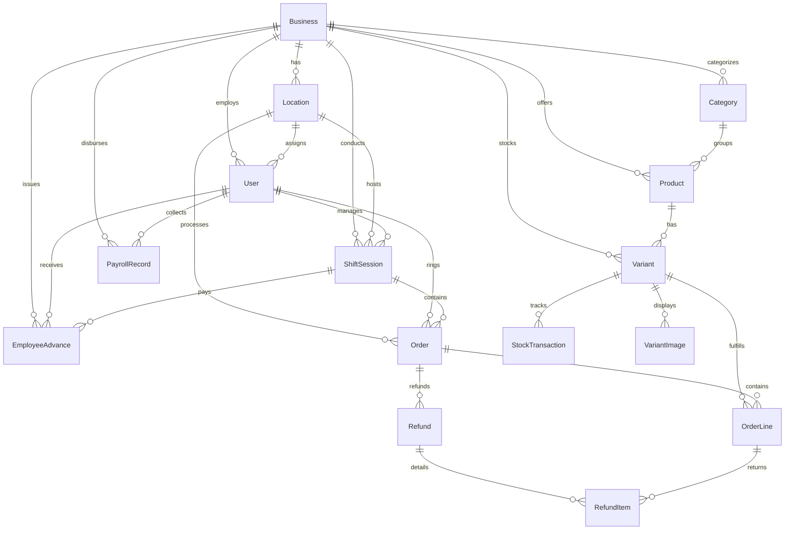

# SunTech POS: Master Backend Architecture & API Specification

> **Version:** 2.0.0  
> **Framework:** NestJS 11 + Express + Prisma ORM 6 + PostgreSQL 16  
> **Status:** Production-Ready Core  
> **Single Source of Truth:** Documents all architectural guardrails, data contracts, security mechanics, and edge case behaviors across all backend services.

---

## 1. Global Architecture & System Guardrails

### 1.1 Global Exception Filter (`GlobalExceptionFilter`)

- **File:** [`src/common/filters/global-exception.filter.ts`](file:///d:/Project/SuntechPOS-backend/src/common/filters/global-exception.filter.ts)
- **Envelope Format:**
  ```json
  {
    "success": false,
    "message": "Human-readable error description or array of validation errors",
    "timestamp": "2026-10-18T12:00:00.000Z"
  }
  ```
- **Security & Sanitization:**
  - Catches all `HttpException` instances and extracts response messages cleanly.
  - Catches unhandled system errors (`500 Internal Server Error`) and logs internal error stacks via NestJS `Logger` while masking the user-facing message strictly as `"Internal server error"`.
  - Catches Prisma database errors (such as `P2002` unique constraint violations or `P2025` record not found) and translates them into appropriate HTTP status codes (`409 Conflict`, `404 Not Found`).

### 1.2 Global Response Transform (`TransformInterceptor`)

- **File:** [`src/common/interceptors/transform.interceptor.ts`](file:///d:/Project/SuntechPOS-backend/src/common/interceptors/transform.interceptor.ts)
- **Envelope Format:**
  ```json
  {
    "success": true,
    "message": "Entity created / loaded successfully",
    "data": { ... },
    "timestamp": "2026-10-18T12:00:00.000Z"
  }
  ```
- **Behaviors:**
  - Uses `@ResponseMessage('...')` decorator set on controller handlers. Defaults to `"Success"` if omitted.
  - Bypasses file stream responses (`StreamableFile` for PDF/CSV exports) so binary data is streamed directly with attachment headers without JSON encapsulation.

### 1.3 Idempotency Engine (`IdempotencyInterceptor` & `IdempotencyRecord`)

- **File:** [`src/common/interceptors/idempotency.interceptor.ts`](file:///d:/Project/SuntechPOS-backend/src/common/interceptors/idempotency.interceptor.ts)
- **Database Model:** `IdempotencyRecord` in PostgreSQL with compound index `@@unique([scopeId, key])`.
- **Header:** `Idempotency-Key` (1–200 characters string).
- **Execution Flow & Concurrency Control:**
  1. **Method Check:** Only intercepts mutating methods (`POST`, `PATCH`, `PUT`, `DELETE`). `GET`, `HEAD`, `OPTIONS` pass through automatically.
  2. **Scope Resolution:** Scoped per user `actor.sub`. If anonymous, resolves to client IP (`x-forwarded-for` or socket remote address).
  3. **Atomic In-Flight Lock:** Creates an `IdempotencyRecord` with `statusCode: 0` (`PENDING_STATUS`) inside PostgreSQL. If two concurrent identical requests hit the server, PostgreSQL rejects the second with a unique constraint error (`P2002`), causing the interceptor to return `409 Conflict` (`"A request with this idempotency key is already in progress"`).
  4. **Path Mismatch Rejection:** If an existing key was already used for a different endpoint path, throws `409 Conflict` (`"Idempotency key was already used for a different request"`).
  5. **Replay Cache (24-Hour TTL):** If a completed record exists and `expiresAt > now()`, immediately serves the stored `responseBody` with the exact stored `statusCode` without re-executing controller logic.
  6. **Safe Lock Release on Failure:** If the underlying handler throws an error, the in-flight lock (`statusCode: 0`) is deleted immediately so the client can safely retry without being locked out.
- **Storage Architecture:**
  - Implemented directly in PostgreSQL via Prisma for ACID transaction durability across server restarts.
  - _Roadmap for High-Concurrency Redis Upgrade:_ Can be adapted to Redis `SET key value NX PX 86400000` for sub-millisecond lock acquisition.

### 1.4 Cryptography & Authentication Security

- **Password Hashing:**
  - Uses `bcrypt` with `BCRYPT_ROUNDS = 10`.
  - Protects against timing attacks using `bcrypt.compare()` constant-time checks.
  - Passwords must meet minimum complexity requirements (min 8 chars, uppercase, lowercase, number, special char).
- **One-Time Passwords (OTP):**
  - Generated with cryptographically secure pseudo-random numbers via Node.js `crypto.randomInt(100000, 1000000).toString()` (6-digit numeric OTP).
  - Plaintext OTP is **never** saved in the database; it is hashed with `bcrypt` (`resetOtpHash`) and verified with `bcrypt.compare()`.
  - Strictly expires in 15 minutes (`OTP_TTL_MS = 15 * 60 * 1000`).
- **JWT Token Lifecycles & Claims:**
  - `JWT_ACCESS_SECRET` / `JWT_ACCESS_TTL` (default `7d`).
  - `JWT_REFRESH_SECRET` / `JWT_REFRESH_TTL` (default `30d`).
  - Claims by Role:
    - `SUPER_ADMIN`: `{ sub, role: 'SUPER_ADMIN' }`
    - `ADMIN`: `{ sub, role: 'ADMIN', businessId }`
    - `CASHIER`: `{ sub, role: 'CASHIER', publicId, businessId, locationId }`
  - Password Reset Token: short-lived (`10m`), signed with dedicated payload `{ sub, email, purpose: 'password-reset' }`. Only accepted by `POST /auth/reset-password`.

### 1.5 Rate Limiting (`ThrottlerGuard`)

- **File:** Configured globally in [`src/app.module.ts`](file:///d:/Project/SuntechPOS-backend/src/app.module.ts).
- **Policy:**
  - Default global rate limit: 60 requests per minute (`60_000ms`, `limit: 60`).
  - Sensitive auth routes (`/auth/login`, `/auth/register`, `/auth/forgot-password`, `/auth/verify-otp`, `/auth/reset-password`): strictly throttled to 5 requests per minute (`@Throttle({ default: { limit: 5, ttl: 60_000 } })`).
  - Excess requests receive `429 Too Many Requests` (`"ThrottlerException: Too Many Requests"`).

### 1.6 Salary Masking Interceptor (`SalaryMaskingInterceptor`)

- **File:** [`src/common/interceptors/salary-masking.interceptor.ts`](file:///d:/Project/SuntechPOS-backend/src/common/interceptors/salary-masking.interceptor.ts)
- **Rule:** Cashiers must never observe salaries in any API response.
- **Mechanism:**
  - Recursively walks response payloads (objects, arrays, nested relations).
  - Whenever `request.user?.role === Role.CASHIER`, strips `monthlySalary` completely from the serialized JSON payload.
  - Verified across direct user lookups, staff lists, and embedded relations.

### 1.7 Integer Currency Discipline & Overflow Protection

- **Files:** [`src/orders/money.ts`](file:///d:/Project/SuntechPOS-backend/src/orders/money.ts), Prisma Schemas.
- **Storage Standard:** All financial amounts are stored as whole integer numbers representing currency subunits (BDT taka / paisa).
- **Guards:**
  - Prevents IEEE-754 floating-point inaccuracies (e.g., `0.1 + 0.2 !== 0.3`).
  - Overflow protection asserts amounts do not exceed PostgreSQL 32-bit signed integer limits (`INT_MAX = 2,147,483,647`).
  - Negative value validation asserts monetary inputs (`amount`, `sellingPrice`, `startingAmount`, `unitPrice`) are non-negative.

### 1.8 Soft-Delete Mechanics & Collision-Free Code Reuse

- **Files:** [`src/catalog/category.service.ts`](file:///d:/Project/SuntechPOS-backend/src/catalog/category.service.ts), [`src/catalog/product.service.ts`](file:///d:/Project/SuntechPOS-backend/src/catalog/product.service.ts), [`src/catalog/variant.service.ts`](file:///d:/Project/SuntechPOS-backend/src/catalog/variant.service.ts).
- **Mechanism:**
  - Entities use `deletedAt: DateTime?`. Active entities satisfy `deletedAt: null`.
  - When soft-deleting a Category, Product, or Variant, unique columns (`name`, `slug` on Category; `name` on Product; `sku`, and `barcode` if present on Variant) are appended with `__del_${Date.now()}`.
  - **Result:** Allows an admin to recreate a product with the identical SKU or barcode immediately without triggering PostgreSQL unique index conflicts (`P2002`).

### 1.9 Multi-Tenant Isolation & Hierarchical Location Scoping (`resolveLocationScope`)

- **File:** [`src/common/utils/location-scope.ts`](file:///d:/Project/SuntechPOS-backend/src/common/utils/location-scope.ts)
- **Hierarchy:** `Business (Tenant) 1 ──> N Locations (Branches) 1 ──> N Cashiers / Orders / Shifts`.
- **Enforcement:**
  - **Caller is `CASHIER`:** `businessId` and `locationId` are strictly resolved from the authenticated JWT token. Any attempt to supply a different `locationId` in the query or body throws `403 Forbidden` (`"Cashiers can only query their assigned store location"`).
  - **Caller is `ADMIN`:** `businessId` is resolved from the JWT token. Admin can pass optional `locationId` to filter down to a specific store branch, or omit `locationId` to aggregate across all branches.
  - Cashiers with no assigned `locationId` or `businessId` in DB are blocked from logging in.

### 1.10 Asynchronous Processing & Queue Roadmap

- **Current State:**
  - Email dispatch: Direct asynchronous delivery via Nodemailer SMTP with HTML templates (`EmailTemplateService`).
  - Report generation: In-memory streaming via PDFKit and CSV buffers (`ExportService`).
- **Enterprise Scaling Roadmap (BullMQ + Redis):**
  - Mail Queue: Move `mailService.deliver()` to BullMQ `@Processor('mail')` with Redis backing, providing exponential backoff retries, dead-letter queues, and decoupling SMTP latency from HTTP requests.
  - Report Queue: Offload complex multi-year analytics PDF generation to BullMQ `@Processor('reports')` with pre-signed Cloudinary/S3 download links.

### 1.11 Cloudinary Media Storage

- **File:** [`src/media/cloudinary.service.ts`](file:///d:/Project/SuntechPOS-backend/src/media/cloudinary.service.ts)
- **Rules:**
  - File uploads handled via `multer.memoryStorage()`.
  - Uploads stream buffer directly to Cloudinary folder `suntech-pos/{folder}` with eager thumbnail transformations.
  - Old images are deleted eagerly using `cloudinary.uploader.destroy(publicId)` upon replacement or deletion to prevent orphaned cloud storage bloat.

### 1.12 Automated Database Seeding (`prisma/seed.ts` & `SeedService`)

- **Files:** [`prisma/seed.ts`](file:///d:/Project/SuntechPOS-backend/prisma/seed.ts), [`src/admin/seed.service.ts`](file:///d:/Project/SuntechPOS-backend/src/admin/seed.service.ts).
- **Execution:**
  - CLI: `npm run prisma:seed` or `npx prisma db seed`.
  - Runtime Bootstrap: `SeedService` runs on `OnModuleInit` if `process.env.NODE_ENV !== 'test'` and no `SUPER_ADMIN` exists in the database.
- **Seeded Entities (Idempotent Upserts):**
  1. `SUPER_ADMIN`: `superadmin@suntech.pos` (`ADM-SUPER`).
  2. `ADMIN`: `admin@suntechpos.bd` (`ADM-8X9B2`).
  3. `Business`: `"SunTech Retail"`.
  4. `Location`: `"Uttara Doyel Branch"`.
  5. `CASHIER`: `Alex Rivera` (`CSH-UTT01`, monthlySalary: 35000) assigned to `"Uttara Doyel Branch"`.

---

## 2. Complete Domain Database Schemas



---

## 3. Complete Endpoint Specification & Error Matrix

### 3.1 Authentication & Password Recovery (`/api/v1/auth`)

#### `POST /auth/register`

- **Access:** Public (`@Idempotent()`, Throttled 5 req/min)
- **DTO Validation:**
  - `fullName`: `@IsString()`, `@MinLength(2)`
  - `email`: `@IsEmail()`, normalized to lowercase
  - `password`: `@IsString()`, `@MinLength(8)`, `@Matches(/^(?=.*[a-z])(?=.*[A-Z])(?=.*\d)(?=.*[@$!%*?&])/)`
  - `phoneNumber`: `@IsOptional()`, `@IsPhoneNumber()`
- **Behavior:** Creates an Admin account with status `PENDING_APPROVAL`.
- **Edge Cases & Errors:**
  - `409 Conflict`: If email or phone number is already registered (`P2002`).
  - `400 Bad Request`: Password complexity failure.

#### `POST /auth/login`

- **Access:** Public (Throttled 5 req/min)
- **DTO Validation:**
  - `loginType`: `@IsEnum(LoginType)` (`ADMIN` | `CASHIER` | `BUSINESS_USER`)
  - `email`: `@IsOptional()`, required if `loginType === 'ADMIN'`
  - `publicId`: `@IsOptional()`, required if `loginType !== 'ADMIN'`
  - `password`: `@IsString()`, `@MinLength(1)`
- **Guardrails & Edge Cases:**
  - `401 Unauthorized`: Invalid credentials, wrong password, or user not found.
  - `403 Forbidden`: Account `PENDING_APPROVAL`, `SUSPENDED`, or `REJECTED`.
  - `403 Forbidden`: Cashier without assigned active `businessId` or `locationId`.
  - `400 Bad Request`: Calling with `loginType: ADMIN` using a Cashier account (or vice-versa).
- **Response:** `{ accessToken, refreshToken, user: { id, publicId, fullName, email, role, status, businessId, locationId } }`.

#### `POST /auth/refresh`

- **Access:** Public
- **DTO:** `{ refreshToken: string }`
- **Behavior:** Verifies JWT signature using `JWT_REFRESH_SECRET`, verifies user exists and is active, and issues a fresh `accessToken`.
- **Edge Cases:** `401 Unauthorized` on expired or tampered token.

#### `POST /auth/forgot-password`

- **Access:** Public (Throttled 5 req/min)
- **DTO:** `{ email: string }`
- **Behavior:** Looks up user by email. If found, generates 6-digit OTP, bcrypt-hashes it into `resetOtpHash`, sets `otpExpiry = now + 15m`, and dispatches an HTML email via `MailService`. Returns `{ success: true, message: 'OTP sent' }` even if user not found (preventing email enumeration).

#### `POST /auth/verify-otp`

- **Access:** Public (Throttled 5 req/min)
- **DTO:** `{ email: string, otp: string }`
- **Behavior:** Verifies OTP against `resetOtpHash`. If valid and not expired, returns short-lived signed JWT `resetToken` (10m TTL).
- **Edge Cases:**
  - `400 Bad Request`: OTP expired or invalid.
  - `404 Not Found`: Account not found.

#### `POST /auth/reset-password`

- **Access:** Public (`@Idempotent()`, Throttled 5 req/min)
- **DTO:** `{ resetToken: string, newPassword: string }`
- **Behavior:** Verifies `resetToken` claims (`purpose === 'password-reset'`), bcrypt-hashes `newPassword`, clears `resetOtpHash` and `otpExpiry`.
- **Edge Cases:** `401 Unauthorized` if token is expired, invalid, or forged.

---

### 3.2 Platform Administration (`/api/v1/admin`)

#### `GET /admin/users`

- **Access:** `@Roles(Role.SUPER_ADMIN)`
- **Query Parameters:** `status?: AccountStatus`, `search?: string`, `page?: number = 1`, `limit?: number = 20`.
- **Behavior:** Lists admin accounts with owned business details and branch count `_count: { locations: true }`.

#### `PATCH /admin/users/:id/approve`

- **Access:** `@Roles(Role.SUPER_ADMIN)` (`@Idempotent()`)
- **Behavior:** Transitions admin status from `PENDING_APPROVAL` to `ACTIVE` and mints public identifier `ADM-XXXXX`.
- **Edge Cases:** `400 Bad Request` if user is already approved or not an Admin.

#### `PATCH /admin/users/:id/status`

- **Access:** `@Roles(Role.SUPER_ADMIN)`
- **DTO:** `{ status: AccountStatus, statusReason?: string }`
- **Behavior:** Allows Super Admin to `SUSPEND` or `REJECT` an admin account with an optional audit reason.

---

### 3.3 Tenant & Multi-Location (`/api/v1/tenant`)

#### `POST /tenant/business`

- **Access:** `@Roles(Role.ADMIN)` (`@Idempotent()`)
- **DTO:** `{ name: string }`
- **Behavior:** Creates business owned by caller, links caller's `businessId`, and re-issues an updated JWT accessToken containing the new `businessId`.
- **Edge Cases:** `409 Conflict` if the admin already owns a business.

#### `GET /tenant/business`

- **Access:** `@Roles(Role.ADMIN, Role.CASHIER)`
- **Behavior:** Returns current business profile scoped to `actor.businessId`.

#### `POST /tenant/business/profile-image` & `DELETE /tenant/business/profile-image`

- **Access:** `@Roles(Role.ADMIN)`
- **Behavior:** Uploads image buffer to Cloudinary (`suntech-pos/business`), sets `profileImageUrl` & `profileImagePublicId`, eagerly destroys previous image.

#### `POST /tenant/locations`

- **Access:** `@Roles(Role.ADMIN)` (`@Idempotent()`)
- **DTO:** `{ name: string, address?: string }`
- **Behavior:** Creates a branch location under caller's `businessId`.
- **Edge Cases:** `409 Conflict` if location name already exists within the business.

#### `GET /tenant/locations`

- **Access:** `@Roles(Role.ADMIN, Role.CASHIER)`
- **Query:** `locationId?: string`, `search?: string`.
- **Behavior:** Cashiers automatically receive only their assigned location. Admins receive all locations or filter by ID/name.

#### `PATCH /tenant/locations/:id` & `DELETE /tenant/locations/:id`

- **Access:** `@Roles(Role.ADMIN)`
- **Behavior:** Updates or soft-deletes a store branch location.
- **Edge Cases:** `404 Not Found` if location does not belong to caller's `businessId`.

---

### 3.4 Staff Management (`/api/v1/users`)

#### `POST /users/cashiers`

- **Access:** `@Roles(Role.ADMIN)` (`@Idempotent()`)
- **DTO:**
  - `fullName`: `@IsString()`, `@MinLength(2)`
  - `email`: `@IsEmail()`
  - `phoneNumber`: `@IsOptional()`, `@IsPhoneNumber()`
  - `password`: `@IsString()`, min 8 chars
  - `locationId`: `@IsUUID()` (must belong to caller's `businessId`)
  - `monthlySalary`: `@IsInt()`, `@Min(0)`
- **Behavior:** Creates Cashier with `status: ACTIVE`, mints `CSH-XXXXX`, links to `locationId`.
- **Edge Cases:** `400 Bad Request` if `locationId` does not exist or belongs to another business.

#### `GET /users/cashiers`

- **Access:** `@Roles(Role.ADMIN)`
- **Query:** `locationId?: string`, `status?: AccountStatus`, `search?: string`.
- **Behavior:** Lists staff with assigned branch location details and salary information.

#### `PATCH /users/cashiers/:id`

- **Access:** `@Roles(Role.ADMIN)`
- **DTO:** `fullName?: string`, `phoneNumber?: string`, `locationId?: string`, `monthlySalary?: number`.
- **Behavior:** Updates staff details, reassigns location, or adjusts base salary.

#### `DELETE /users/cashiers/:id`

- **Access:** `@Roles(Role.ADMIN)`
- **Behavior:** Soft-deletes cashier account (`deletedAt = new Date()`).

---

### 3.5 Catalog & Inventory (`/api/v1/catalog`)

#### Categories (`/catalog/categories`)

- `GET /catalog/categories`: Allowed for `ADMIN`, `CASHIER`.
  - Query: `search?: string`.
  - Returns category tree with aggregated analytics: `productsCount`, `activeSkus`, `totalUnits`, `inventoryValue`, `salesCount`, `salesRevenue`.
- `POST /catalog/categories` (`ADMIN`): Creates category. Unique on `name` within business.
- `PATCH /catalog/categories/:id` (`ADMIN`): Updates name/description.
- `DELETE /catalog/categories/:id` (`ADMIN`): Soft delete suffixes `name` and `slug` with `__del_${timestamp}`.

#### Products (`/catalog/products`)

- `GET /catalog/products`: Allowed for `ADMIN`, `CASHIER`.
  - Query: `categoryId?: string`, `search?: string` (matches product name, description, variant SKU, or barcode).
  - Returns products with nested active variants and category info.
- `POST /catalog/products` (`ADMIN`): Creates product within business and assigns optional `categoryId`.
- `PATCH /catalog/products/:id` (`ADMIN`): Updates product details.
- `DELETE /catalog/products/:id` (`ADMIN`): Soft delete suffixes `name` with `__del_${timestamp}`.

#### Variants & Inventory (`/catalog/variants`)

- `GET /catalog/variants`: Allowed for `ADMIN`, `CASHIER`.
  - Query: `categoryId?: string`, `productId?: string`, `search?: string`, `lowStockOnly?: boolean`.
  - Calculates `marginPercent = Math.round(((sellingPrice - costPrice) / sellingPrice) * 100)`.
  - `lowStockOnly=true` strictly filters items with `stock <= 5`.
- `POST /catalog/variants` (`ADMIN`): Creates variant with `sku` (auto-generated or custom), `barcode`, `sellingPrice`, `costPrice`, `stock`.
- `PATCH /catalog/variants/:id` (`ADMIN`): Updates pricing, barcode, or stock.
- `DELETE /catalog/variants/:id` (`ADMIN`): Soft delete suffixes `sku` and non-null `barcode` with `__del_${timestamp}`.

---

### 3.6 Smart Shift Lifecycle (`/api/v1/shifts`)

#### `POST /shifts/open`

- **Access:** `@Roles(Role.CASHIER, Role.ADMIN)` (`@Idempotent()`)
- **DTO:**
  - `startingAmount`: `@IsInt()`, `@Min(0)`
  - `locationId?: string` (required for Admin; ignored and taken from token for Cashier)
  - `autoClosePrevious?: boolean`
- **Smart Auto-Close Logic:**
  - **Case A (Stale Shift from Yesterday):** If caller has an `OPEN` shift whose `openedAt` is before start of today (or `autoClosePrevious === true`), atomically auto-closes the stale shift first:
    - `cashSales`: Sum of paid COD orders in that shift.
    - `advancesOut`: Sum of cash advances paid in that shift.
    - `expectedAmount = startingAmount + cashSales - advancesOut`.
    - Sets `closingAmount = expectedAmount`, `variance = 0`, `status = 'CLOSED'`, `closedAt = now()`.
    - Creates and returns new shift with `autoClosedPreviousShiftId`.
  - **Case B (Same-Day Active Shift):** Returns `409 Conflict` (`"You already have an open shift today"`), preventing accidental drawer resets.

#### `GET /shifts/active`

- **Access:** `@Roles(Role.CASHIER, Role.ADMIN)`
- **Behavior:** Returns currently active open shift for the caller, including live telemetry: `openingFloat`, `cashSales`, `advancesOut`, `expectedCash`, and full `advanceLedger`.

#### `POST /shifts/close` & `POST /shifts/:id/close`

- **Access:** `@Roles(Role.CASHIER, Role.ADMIN)` (`@Idempotent()`)
- **DTO:** `{ closingAmount: number, notes?: string }`
- **Behavior:** Computes `expectedAmount = startingAmount + cashSales - advancesOut`, calculates `variance = closingAmount - expectedAmount`, marks shift as `CLOSED`.

#### `POST /shifts/advances`

- **Access:** `@Roles(Role.CASHIER, Role.ADMIN)` (`@Idempotent()`)
- **DTO:** `{ amount: number, reason?: string }`
- **Behavior:** Records an employee advance taken directly out of the shift drawer float, incrementing `shift.advancesOut`.

#### `GET /shifts`

- **Access:** `@Roles(Role.CASHIER, Role.ADMIN)`
- **Query:** `locationId?: string`, `status?: ShiftStatus`, `page?: number = 1`, `limit?: number = 10`.
- **Behavior:** Returns paginated shift history scoped to location.

---

### 3.7 Dual-Engine Orders & Refunds (`/api/v1/orders`)

#### `POST /orders/catalog`

- **Access:** `@Roles(Role.CASHIER, Role.ADMIN, Role.SUPER_ADMIN)` (`@Idempotent()`)
- **DTO:**
  - `items`: Array of `{ variantId: string, quantity: number }`
  - `paymentMethod`: `COD` | `BKASH` | `NAGAD` | `BANK`
  - `tenderedAmount`: `@IsInt()`, `@Min(0)`
  - `customerName?: string`, `customerPhone?: string`
  - `locationId?: string`
- **Transaction Execution:**
  1. Validates location belongs to tenant; Cashiers locked to token location.
  2. Queries variants and validates active stock: throws `400 Bad Request` if `variant.stock < item.quantity`.
  3. Decrements variant stock and writes `StockTransaction(type: SALE)`.
  4. Generates unique `invoiceNumber` (`INV-YYYYMMDD-XXXX`).
  5. Computes `changeDue = tenderedAmount - totalAmount`.
  6. Increments active shift `cashCollected` **only if** `paymentMethod === 'COD'`. Digital payments do not alter cash drawer float.

#### `POST /orders/custom`

- **Access:** `@Roles(Role.CASHIER, Role.ADMIN, Role.SUPER_ADMIN)` (`@Idempotent()`)
- **DTO:**
  - `items`: Array of `{ description: string, quantity: number, unitPrice: number }`
  - `paymentMethod`: `COD` | `BKASH` | `NAGAD` | `BANK`
  - `tenderedAmount`: `@IsInt()`, `@Min(0)`
  - `customerName?: string`, `customerPhone?: string`
- **Behavior:** Handles unlisted retail accessories, repair services, or custom ad-hoc orders. Bypasses inventory stock deduction while recording full financial and shift ledger data.

#### `GET /orders`

- **Access:** `@Roles(Role.CASHIER, Role.ADMIN, Role.SUPER_ADMIN)`
- **Query Parameters:**
  - `search?: string` (matches invoice, receipt, customer name, customer phone, customer number, product name)
  - `paymentMethod?: PaymentMethod`
  - `status?: OrderStatus`
  - `orderType?: OrderType`
  - `range?: 'today' | 'yesterday' | 'weekly' | 'monthly'`
  - `locationId?: string`
  - `page?: number = 1`, `limit?: number = 20`

#### `POST /orders/:id/refunds`

- **Access:** `@Roles(Role.ADMIN)` (`@Idempotent()`)
- **DTO:**
  - `reason?: string`
  - `items`: Array of `{ orderLineId: string, quantity: number }`
- **Behavior:**
  - Validates returned quantities do not exceed unrefunded order line quantities.
  - Restores variant inventory stock and records `StockTransaction(type: REFUND)`.
  - Creates `Refund` record with auditor `processedById = actor.sub`.
  - If 100% of order lines are returned, marks `Order.status = REFUNDED`.

---

### 3.8 HR Advance Ledger & Payroll (`/api/v1/advances` & `/api/v1/payroll`)

#### `GET /advances`

- **Access:** `@Roles(Role.ADMIN, Role.CASHIER)`
- **Query Parameters:**
  - `locationId?: string`
  - `cashierId?: string`
  - `month?: number` (1–12)
  - `year?: number` (2000–2100)
  - `status?: AdvanceStatus` (`PENDING` | `DEDUCTED`)
- **Role Scoping:**
  - Cashiers locked to `cashierId = actor.sub` and `locationId = actor.locationId`.
  - Admins scoped to `actor.businessId` with multi-filter support.
- **Response Payload:**
  ```json
  {
    "items": [
      {
        "id": "cuid...",
        "cashierId": "uuid...",
        "employeeName": "Tariqul Islam",
        "employeeCode": "CSH-8X9B2",
        "role": "CASHIER",
        "locationName": "Uttara Doyel Branch",
        "amount": 1000,
        "reason": "Emergency Medical Advance",
        "status": "PENDING",
        "takenAt": "2026-10-18T12:00:00.000Z",
        "createdAt": "2026-10-18T12:00:00.000Z"
      }
    ],
    "summary": {
      "totalActiveAdvances": 1000,
      "pendingCount": 1,
      "deductedCount": 0
    }
  }
  ```

#### `GET /payroll/summary`

- **Access:** `@Roles(Role.ADMIN)`
- **Query Parameters:** `month?: number`, `year?: number`, `locationId?: string`.
- **Behavior:** Aggregates staff base salaries, pending advances in the payroll period, and net payable amounts. Returns disbursement status (`DISBURSED`, `PARTIAL`, `PENDING`).

#### `POST /payroll/disburse`

- **Access:** `@Roles(Role.ADMIN)` (`@Idempotent()`)
- **DTO:** `{ month: number, year: number, locationId?: string }`
- **Behavior:** Atomically disburses payroll in bulk for all pending salaried staff:
  1. Deducts active pending advances in the period and sets advance status to `DEDUCTED`.
  2. Computes `netPaid = baseSalary - totalAdvancesDeducted`.
  3. Creates `PayrollRecord` with unique constraint `[cashierId, month, year]`.
  4. Prevents duplicate payments for staff already paid for that period.

---

### 3.9 Executive Cockpit & Reports Analytics (`/api/v1/reports`)

#### `GET /reports/dashboard`

- **Access:** `@Roles(Role.ADMIN, Role.CASHIER)`
- **Query Parameters:**
  - `range?: 'today' | 'yesterday' | 'weekly' | 'monthly'`
  - `locationId?: string`
- **Response for `Role.ADMIN`:**
  ```json
  {
    "globalDailyRevenue": 148200,
    "globalRolling30DayRevenue": 3450000,
    "staffLeaderboard": [
      {
        "cashierId": "c1",
        "fullName": "Alex Rivera",
        "publicId": "CSH-UTT01",
        "revenue": 84000
      }
    ],
    "periodRevenue": 148200,
    "ordersCount": 94,
    "averageTicketValue": 1577,
    "grossMarginPercent": 24.2,
    "paymentBreakdown": {
      "cashAmount": 91884,
      "digitalAmount": 56316,
      "cashPercentage": 62,
      "digitalPercentage": 38,
      "byMethod": {
        "COD": 91884,
        "BKASH": 35000,
        "NAGAD": 15000,
        "BANK": 6316
      }
    },
    "topCategories": [
      { "name": "Smartphones", "revenue": 84997, "percentage": 57.3 },
      { "name": "Chargers & Adapters", "revenue": 26500, "percentage": 17.9 },
      { "name": "Earbuds & Audio", "revenue": 19850, "percentage": 13.4 }
    ],
    "recentTickets": [
      {
        "id": "uuid...",
        "invoiceNumber": "INV-20261018-0094",
        "customerName": "Walk-in Customer",
        "itemsSummary": "Infinix 45W Fast Charger Kit (x1)",
        "paymentMethod": "COD",
        "totalAmount": 1500,
        "status": "PAID",
        "createdAt": "2026-10-18T13:45:00.000Z"
      }
    ]
  }
  ```
- **Response for `Role.CASHIER`:**
  ```json
  {
    "myDailyRevenue": 35000,
    "myDailyUnitsSold": 24,
    "myMonthlyRevenue": 480000
  }
  ```

#### `GET /reports/analytics`

- **Access:** `@Roles(Role.ADMIN)`
- **Query Parameters:**
  - `range?: 'daily' | 'weekly' | 'monthly' | 'quarterly' = 'monthly'`
  - `locationId?: string`
- **Response:** Returns executive period analytics matching the `/admin/reports` table:
  ```json
  {
    "grossRevenue": 3450000,
    "ordersCount": 2180,
    "averageTicketValue": 1583,
    "grossMarginPercent": 25.4,
    "cashPercentage": 65,
    "digitalPercentage": 35,
    "paymentBreakdown": {
      "cashAmount": 2242500,
      "digitalAmount": 1207500,
      "cashPercentage": 65,
      "digitalPercentage": 35,
      "byMethod": {
        "COD": 2242500,
        "BKASH": 800000,
        "NAGAD": 300000,
        "BANK": 107500
      }
    },
    "topCategories": [
      { "name": "Smartphones", "revenue": 1966500, "percentage": 57.0 },
      { "name": "Audio", "revenue": 690000, "percentage": 20.0 }
    ]
  }
  ```

#### `GET /reports/transactions`

- **Access:** `@Roles(Role.ADMIN)`
- **Query:** `page?: number = 1`, `limit?: number = 20`, `locationId?: string`, `search?: string`, `range?: string`.
- **Behavior:** Paginated audit log with complete order totals, change due, customer contact details, cashier identity, and detailed line items.

#### `GET /reports/export`

- **Access:** `@Roles(Role.ADMIN)`
- **Query:**
  - `type: 'payroll' | 'sales'`
  - `format: 'csv' | 'pdf'`
  - `month: number` (1–12)
  - `year: number` (2000–2100)
  - `locationId?: string`
  - `search?: string`
- **Behavior:** Generates and streams branded `text/csv` or `application/pdf` (via PDFKit) with formatted tables, column headers, and totals.

---

## 4. Verification & Testing Standards

All code commits must satisfy the following zero-error verification standard:

1. **Prettier Formatting:**
   ```bash
   npx prettier --check "src/**/*.ts" "docs/POS.md"
   ```
2. **Jest Unit Test Suite:**
   ```bash
   npm test
   ```
   - _Status:_ 22 / 22 test suites passing, 122 / 122 tests passing.
3. **TypeScript Compilation:**
   ```bash
   npm run build
   ```
   - _Status:_ Clean build, zero compilation errors.
